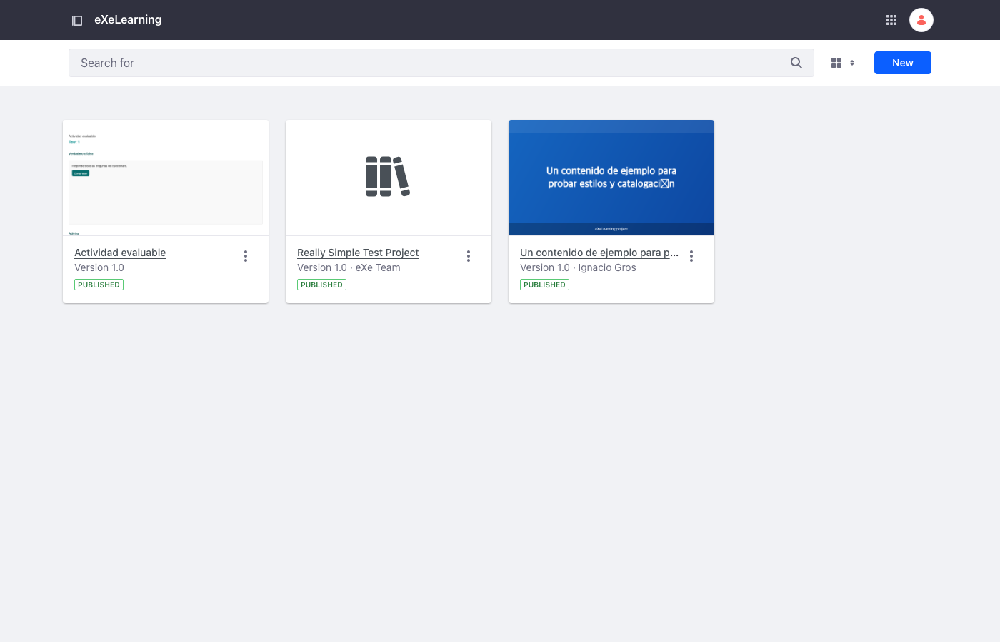
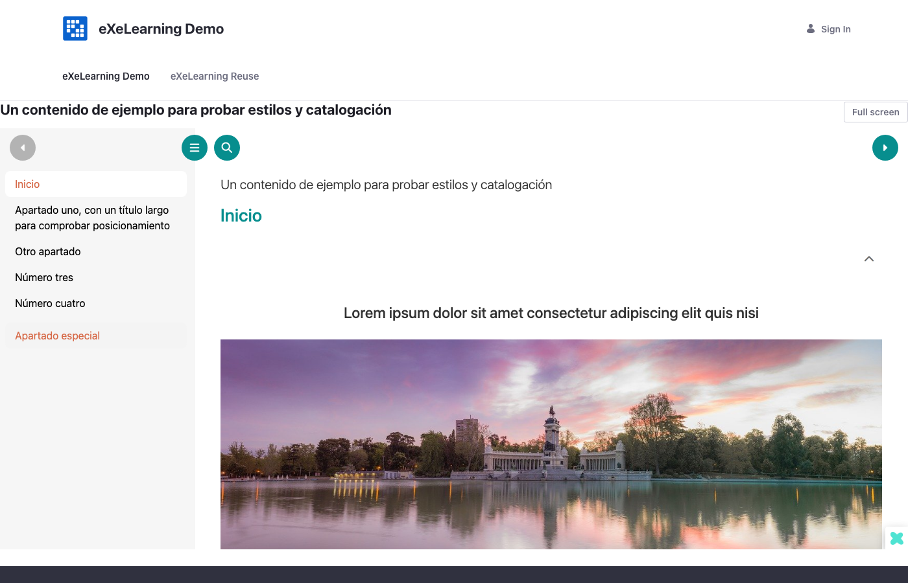
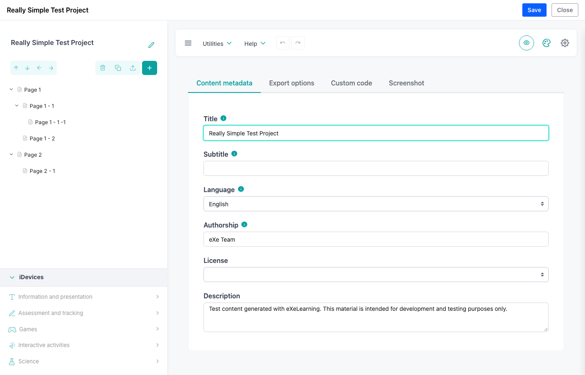

# eXeLearning for Liferay

[](https://github.com/exelearning/liferay-exelearning/actions/workflows/ci.yml)
[](https://codecov.io/gh/exelearning/liferay-exelearning)

> **Manage, publish, embed and edit [eXeLearning](https://exelearning.net) projects (`.elpx`)
> in Liferay Portal and Liferay DXP, preserving eXeLearning's native navigation and
> interactive activities.**

This integration implements [exelearning/exelearning#2575](https://github.com/exelearning/exelearning/issues/2575).
It is a pair of OSGi bundles that use Liferay's own building blocks: Documents and Media for
storage and versioning, Liferay permissions, a Site Administration application with the
standard management toolbar, and a reusable widget for pages.

| Content & Data › eXeLearning | Widget on a page | Embedded editor |
| --- | --- | --- |
|  |  |  |

## Features

- **Import** `.elpx` packages (eXeLearning 4+). Every package is validated as untrusted input
  (ZIP Slip, absolute/Windows paths, server scripts, duplicates, ZIP bombs, entry and size limits,
  hardened XML parsing) before anything is stored.
- **Manage** resources in *Site Administration › Content & Data › eXeLearning*: card or list view
  with the package's `screenshot.png` as thumbnail, search, metadata (title, description, author,
  license, language, eXeLearning version), versions, preview, download, Liferay permissions and
  delete.
- **Publish and unpublish** a specific version. Publication is atomic: a version is extracted,
  verified and moved into place before the published pointer switches, so a failure never breaks
  the version that is online.
- **Embed** published resources with the *eXeLearning* widget (category *Content Management*):
  height, title, full-screen and download options, several widgets per page, and stable references
  that always show the currently published version.
- **Edit** with the bundled static eXeLearning editor (*Edit with eXeLearning*). The editor talks to
  Liferay through eXeLearning's `postMessage` embedding protocol; saving stores a new Documents and
  Media version with optimistic concurrency, and success is reported only after the server stored it.
- **Isolate** untrusted content: published HTML runs in a sandboxed iframe **and** under a
  `Content-Security-Policy: sandbox` response header (opaque origin, no access to the portal
  session), served only through short-lived signed URLs.
- **Respect Liferay permissions** everywhere: Documents and Media permissions on each resource,
  site scoping, virtual instances, and the *eXeLearning* application permission for authors.

## Compatibility

| Platform | Status |
| --- | --- |
| Liferay Portal CE 7.4 GA132 (`liferay/portal:7.4.3.132-ga132`) | Supported, covered by CI |
| Other Liferay 7.4 updates and DXP 7.4 / quarterly releases | Expected to work, **not tested** |
| Java runtime | Bundles target Java 11; tested on the image's Zulu 21 |
| Browsers | Chromium (CI); Firefox passes the E2E suite locally, not part of CI |

See [docs/architecture/research.md](docs/architecture/research.md) for the verified and assumed
compatibility details.

## Install

Download `liferay-exelearning-<version>.zip` from the
[releases](https://github.com/exelearning/liferay-exelearning/releases), check its SHA-256, and copy
both JAR files into Liferay's `deploy` folder. Full instructions, upgrade and uninstall notes:
[docs/installation.md](docs/installation.md).

## Quick start (development)

Requirements: Docker with ~6 GB of memory for the stack, Node.js 22+, GNU Make and Bun (only to
build the editor from source). A local JDK 21 is optional: Gradle runs in a container otherwise.

```bash
cp .env.example .env     # set your own development passwords
make deps                # npm packages, Playwright Chromium, Gradle dependencies
make up                  # builds everything, starts Liferay + PostgreSQL and deploys the bundles
make seed                # demo site, users, roles, resource and pages (safe to repeat)
make health              # checks the portal and every part of the integration
```

The first `make up` downloads the Liferay image and builds the editor, so it takes a while;
later runs reuse the containers, the volumes and the build caches.

- Portal: <http://localhost:8080> — log in as `test@liferay.com` with `LIFERAY_ADMIN_PASSWORD`.
- Demo page: <http://localhost:8080/web/exelearning-demo/exelearning-demo> (public).
- Manage resources: *Site Administration* of **eXeLearning Demo** › *Content & Data* ›
  *eXeLearning*. Open a resource and choose *Edit with eXeLearning* to edit it, then *Publish*.
- Demo users (password `SEED_USER_PASSWORD`): `demo.viewer@exelearning.example.com` (site member),
  `demo.author@exelearning.example.com` (eXeLearning Author) and
  `demo.editor@exelearning.example.com` (eXeLearning Editor).

## Make targets

| Command | Description |
| --- | --- |
| `make help` | List targets and variables |
| `make deps` | Install development dependencies |
| `make up` / `make upd` | Build, start, deploy and wait / start containers only |
| `make down` / `make restart` | Stop (data kept) / restart Liferay |
| `make reset` | **Destructive**: delete containers and volumes, start again |
| `make ps` / `make logs` / `make shell` | Container status, Liferay log, shell |
| `make build` / `make build-editor` | Build everything / the static editor (cached per ref) |
| `make deploy` | Copy changed bundles into the running portal and wait |
| `make seed` / `make health` | Demo data / readiness checks |
| `make lint` / `make fix` | All linters / automatic fixes |
| `make test-unit` / `make test-coverage` | Unit tests / with 90% line coverage gates |
| `make test-integration` / `make test-e2e` | Black-box API tests / Playwright E2E (running stack) |
| `make test` / `make check` | All test suites / full local quality gate |
| `make package VERSION=x.y.z` | Release ZIP with checksums |
| `make screenshots` | Regenerate `docs/images` (running, seeded stack) |
| `make update-skills` | Update the vendored agent skills with `gh skill update` |
| `make clean` | Remove build output |

The editor version comes from [`.editor-version`](.editor-version); override it with
`EXELEARNING_EDITOR_REF` and `EXELEARNING_EDITOR_REF_TYPE` (`tag`, `branch`, `commit` or
`release`). See [docs/development.md](docs/development.md).

## Tests and quality gates

- **Java** (JUnit 4, Mockito, JaCoCo): `make test-coverage` fails below **90 %** line coverage.
- **TypeScript** (Vitest, V8 coverage): same 90 % threshold, measured separately.
- **Integration** (Playwright API tests) and **E2E** (Playwright, Chromium) run against the real
  Liferay stack: import, publication, reuse, editing, republishing, authorization, security,
  restart persistence and failure recovery.
- **Lint**: Liferay Source Formatter, Biome, `tsc --strict`, ShellCheck, actionlint and Compose
  validation.

## Architecture

```text
Liferay ─┬─ org.exelearning.liferay.web (OSGi bundle)
         │    ├─ REST API (JAX-RS)      /o/exelearning/v1
         │    ├─ Content servlet        /o/exelearning-content/{signed token}/…   (sandboxed)
         │    ├─ Editor servlet         /o/exelearning-editor/…                   (static editor)
         │    ├─ Site Administration    Content & Data › eXeLearning (MVC portlet)
         │    └─ Widget                 eXeLearning (instanceable MVC portlet)
         ├─ org.exelearning.liferay.editor (OSGi bundle, static eXeLearning editor only)
         └─ Documents and Media (packages, versions, permissions) + data/exelearning (extracted cache)
```

Details, flows and decisions: [docs/architecture/overview.md](docs/architecture/overview.md) and the
[ADRs](docs/architecture/adr/README.md).

## Security

Uploaded packages and their HTML are untrusted. The threat model, isolation strategy and how to
report vulnerabilities are in [SECURITY.md](SECURITY.md).

## Issues and support

Issue tracking for this integration is centralized in the main
[`exelearning/exelearning`](https://github.com/exelearning/exelearning) repository.
Please [open new issues there](https://github.com/exelearning/exelearning/issues/new) and browse
[existing `liferay`-labeled issues](https://github.com/exelearning/exelearning/issues?q=is%3Aissue+label%3Aliferay)
before reporting a bug or requesting a feature.

## About

Copyright 2026:
ATE (Área de Tecnología Educativa) /
Centro Nacional de Desarrollo Curricular en Sistemas no Propietarios (CeDeC) /
INTEF (Instituto Nacional de Tecnologías Educativas y de Formación del Profesorado).

### License

This program is free software: you can redistribute it and/or modify it under the terms of the
GNU Affero General Public License as published by the Free Software Foundation, either version 3
of the License, or (at your option) any later version ([LICENSE](LICENSE)). Release packages bundle
the eXeLearning editor, which is also AGPL-3.0-or-later; see
[THIRD-PARTY-NOTICES.md](THIRD-PARTY-NOTICES.md).
